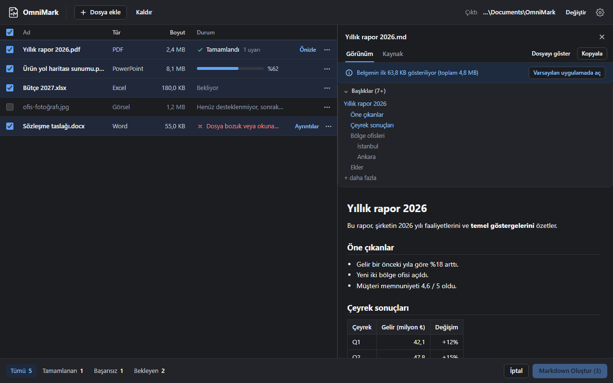

<p align="center">
  
</p>

<p align="center">
  <b>Turn any file into Markdown.</b><br>
  PDF, Word, Excel, PowerPoint, HTML, images, ZIP archives and more. A light, fast, private desktop app for Windows, macOS and Linux.
</p>

<p align="center">
  <a href="https://github.com/KeremV1/OmniMark/releases/latest"></a>
  
  
  
  <a href="LICENSE"></a>
</p>

---

# OmniMark

**OmniMark** converts documents, spreadsheets, slides, web pages, images and ZIP archives into clean Markdown (`.md`). Everything runs on your computer and no file is ever uploaded. It is written in Rust with a Tauri 2 shell, so it opens fast, the installer is about 7 MB and it idles at about 70 MB of memory.

> **Beta (v0.2.0).** OmniMark is usable today and we are looking for feedback. The installers are not code-signed yet, so your system will show a warning the first time; see [Installation](#installation). Please [open an issue](https://github.com/KeremV1/OmniMark/issues/new/choose) for bugs, wrong output or ideas.

## Download

Get the latest version from **[Releases](https://github.com/KeremV1/OmniMark/releases/latest)**:

| System | File |
| --- | --- |
| Windows 10/11 (x64) | `OmniMark_<version>_x64-setup.exe` |
| macOS, Apple silicon (M1 and later) | `OmniMark_<version>_aarch64.dmg` |
| macOS, Intel | `OmniMark_<version>_x64.dmg` |
| Linux x64 (Ubuntu 22.04+ and similar) | `OmniMark_<version>_amd64.AppImage` or `.deb` |

The app checks for new versions at startup and offers to install them; nothing is installed without your click. You can turn the check off in **Settings**.

## Highlights

- **One drop zone for everything:** drop files, folders or ZIP archives, convert them in parallel and preview the result.
- **Faithful output:** headings, lists, tables, links, equations (LaTeX), slide notes, chart data, one table per sheet. Behaviour follows Microsoft [MarkItDown](https://github.com/microsoft/markitdown) and is checked with golden tests.
- **Optional OCR:** reads the text in images, scanned PDF pages and pictures inside Office files. Off by default, one switch to turn it on.
- **Private:** conversion is fully local. The only network requests are the optional update check and, if you use OCR on macOS/Linux, a one-time model download.
- **Light:** ≈7 MB installer, ≈70 MB of memory when idle.
- **7 interface languages:** English, Türkçe, Русский, Deutsch, Español, Français, Português (Brasil). OmniMark follows your system language and falls back to English; you can change it in Settings.

## Supported formats

| Format | Extensions | Output |
| --- | --- | --- |
| PDF | `.pdf` | Text, tables where possible; optional OCR for embedded images and scanned pages |
| Word | `.docx` | Headings, lists, tables, links, equations (LaTeX); optional OCR for images |
| Excel | `.xlsx`, `.xlsm`, `.xls`, `.ods` | One heading and Markdown table per sheet; optional OCR for `.xlsx` images |
| PowerPoint | `.pptx` | Slide titles, text, tables, chart data, speaker notes; optional OCR for images |
| HTML | `.html`, `.htm` | Page content; scripts and styles removed |
| Images | `.png`, `.jpg`, `.jpeg`, `.webp`, `.gif`, `.bmp`, `.tif`, `.tiff` | EXIF/XMP metadata, optional OCR |
| Text | `.txt`, `.md`, `.markdown`, `.json`, `.jsonl`, `.csv` | Plain text; JSON as a code block; CSV as a Markdown table |
| ZIP | `.zip` | Every supported file inside. Output as a folder with the same structure (default), one combined `.md`, or a `.zip` of Markdown files |

Audio transcription is planned for a later version.

## Installation

The beta installers are not signed with a paid developer certificate yet, so the first launch needs one extra step.

**Windows.** Run `OmniMark_<version>_x64-setup.exe`. If SmartScreen says "Windows protected your PC", click **More info → Run anyway**. OmniMark installs for your user only and does not need administrator rights.

**macOS.** Open the `.dmg` and drag OmniMark to **Applications**. On first launch macOS says it cannot verify the developer: open **System Settings → Privacy & Security**, scroll down and click **Open Anyway** next to the OmniMark message, then confirm.

**Linux.** For the AppImage: `chmod +x OmniMark_*.AppImage` and run it. For Debian/Ubuntu: `sudo apt install ./OmniMark_*_amd64.deb`. OmniMark needs WebKitGTK 4.1, which current Ubuntu, Debian, Fedora and Mint releases include.

## How to use

1. Open OmniMark. The first time, a card shows where Markdown files will be saved; click **Change** to pick another folder.
2. Optionally turn on **Settings → OCR**.
3. Drop files, folders or ZIP archives onto the window, or use **Add files** / **Add folder**.
4. Click **Create Markdown**. Progress and errors are shown per file; ✕ on a row or **Cancel** stops the run.
5. Open the output folder, or preview the result inside the app.

## OCR

OCR is optional and off by default. When you turn it on, OmniMark picks the engine:

| System | Engine | Download |
| --- | --- | --- |
| Windows 10/11 | The OCR built into Windows: fast, uses the OCR languages installed in Windows | None |
| macOS, Linux (and Windows without an OCR language) | [ocrs](https://github.com/robertknight/ocrs), pure Rust, Latin-script text | ≈12 MB of models on first use |

Recognized text is placed between `*[Image OCR]` and `[End OCR]*` in the output. The ocrs models are published by the ocrs project under CC BY-SA 4.0 and are downloaded from it at run time; they are not part of the OmniMark installers.

## Command line

The repository also contains a command-line tool built on the same core:

```sh
cargo run -p omnimark-cli -- convert report.pdf -o out
cargo run -p omnimark-cli -- convert photo.jpg --stdout --ocr
cargo run -p omnimark-cli -- convert archive.zip --zip-output folder -o out   # folder | single | zip
cargo run -p omnimark-cli -- models fetch ocrs
```

## Building from source

Requirements: Rust 1.90+ (MSVC toolchain on Windows, plus Visual Studio 2022 Build Tools with the C++ workload), Node.js 20+, and on Linux the WebKitGTK 4.1 development packages.

```sh
scripts/fetch-pdfium.ps1          # Windows; macOS/Linux: bash scripts/fetch-pdfium.sh
npm ci
npm run tauri dev                 # run the app in development mode
npm run tauri build               # build an installer for your system
cargo test --workspace            # Rust tests, including golden tests
npm test                          # UI tests
```

`fetch-pdfium` downloads a pinned, SHA-256-verified [pdfium](https://github.com/bblanchon/pdfium-binaries) build into `vendor/pdfium`; the desktop app does not build without it. See [CONTRIBUTING.md](CONTRIBUTING.md) before opening a pull request.

## Roadmap

| Version | Scope | Status |
| --- | --- | --- |
| 0.1 | Core converters and desktop app: PDF, Word, Excel, PowerPoint, HTML, CSV, text, JSON | ✅ |
| 0.2 (this beta) | Image metadata and OCR, ZIP archives, 7 interface languages, automatic updates, installers for all platforms | ✅ |
| 0.3 | Audio transcription (local, optional module) | Planned |
| 1.0 | Signed installers, hardening and performance work | Planned |

## Acknowledgements

Conversion behaviour is designed by studying Microsoft's [MarkItDown](https://github.com/microsoft/markitdown) (MIT). OmniMark contains no MarkItDown code; it is written from scratch in Rust. MarkItDown's test files and expected outputs are used as golden tests in `tests/fixtures/markitdown/`, with their own MIT notice. Third-party licenses are listed in [THIRD-PARTY-NOTICES.md](THIRD-PARTY-NOTICES.md).

## License

[MIT](LICENSE) © 2026 MoNoR (KeremV1).
